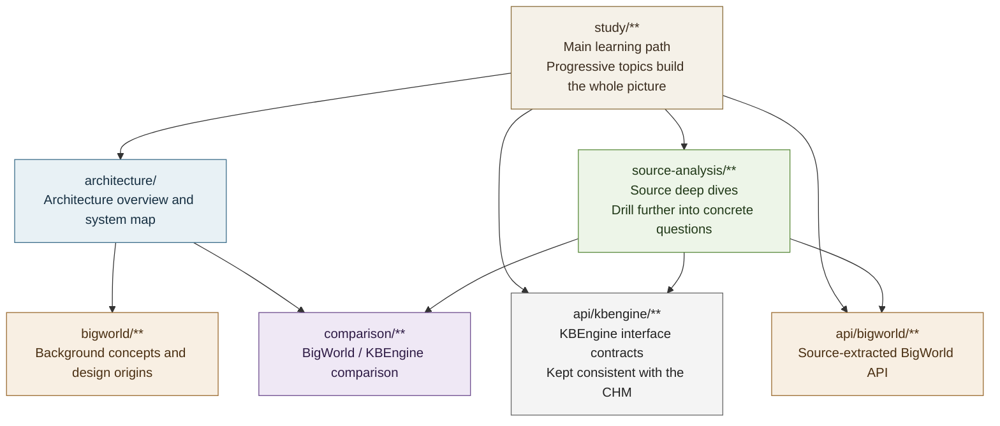

# Architecture Overview

> This page is only a system map; it no longer carries structural design proposals. It answers "where background, deep dives, and comparison belong", not "how the site directories should be renamed".

## System map

## Directory roles

- `BigWorld` builds the conceptual model and answers "why is the architecture designed this way".
- `Source deep dives` chase concrete questions and answer "how is it actually implemented in the current code".
- `Comparison` answers "which ideas came from BigWorld, and where KBEngine turned them into its own implementation".
- `Redesign proposal` is an appendix-style engineering draft, not a main line for source analysis.

This is not a second learning track. For ordered systematic study, still enter [/study/](/study/) first; this area provides the background map, deep-dive entries, and the comparison.

## Recommended reading order

4. [KBEngine 2.0 redesign proposal](redesign.md)

## Current authoring rules

- `architecture/` owns the system map, directory boundaries, and reading routes; it does not expand problem-driven source detail.
- `source-analysis` owns concrete problem study, with the body organized around source paths, call chains, and key classes.
- The `bigworld` directory provides conceptual background and does not replace reading the KBEngine code itself.
- The `comparison` directory records only relationships that have evidence behind them, not assumed "inheritance".
- `redesign` is explicitly an engineering draft, kept separate from source-material transcription.

## Material boundary

- The current `architecture` directory is not a page-by-page transcription of the CHM/PDF material.
- Conclusions in this directory should be based primarily on the repository source, with BigWorld used only as a reference frame.